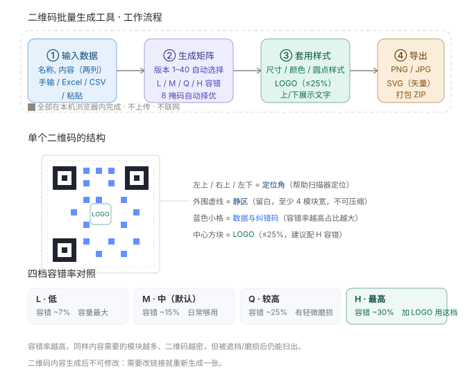

# 二维码工具集（本地离线版）

三个纯前端、零依赖、双击即用的二维码工具。**全程本地处理，不联网、不上传。**

| 工具 | 用途 |
|---|---|
| `qr-batch-offline.html` | **批量生成**：一堆数据 → 一堆带样式的二维码（Excel 导入 / LOGO / 文字 / PNG·JPG·SVG） |
| `qrcode-a4-layout.html` | **A4 排版**：一堆二维码图片 → 每张铺满一整页 A4，打包下载 |

---

# 一、二维码批量生成工具（`qr-batch-offline.html`）

**数据进，二维码出**：把一张表格里的数据，批量生成带样式的二维码，全程不联网。

## 工作原理



## 功能

- **两列数据** —— 第一列「图片名称」、第二列「二维码内容」；名称为空时自动编号
- **数据导入** —— 手动逐行输入，或导入 `.xlsx`（读前两列，自动跳表头）/ `.csv` / `.txt`
- **模板下载** —— 一键下载规范的 CSV 模板，填好直接导回
- **数据整理** —— 查找替换、去首尾空格、去除重复行、删除空行
- **生成前检查** —— 实时统计总条数、唯一条数，并标出内容重复、超长、缺内容的行
- **样式可调** —— 尺寸、静区边距、前景/背景色、四档容错率（L/M/Q/H）、圆点/圆角/方形点样式
- **LOGO 支持** —— 上传 LOGO，占比 10%–25%（上限 25%，避免影响识别）、可选白色留白衬底
- **展示文字** —— 二维码上方或下方显示文字，来源可选「图片名称 / 二维码内容 / 固定文案」
- **多格式导出** —— PNG（支持透明）/ JPG / SVG（纯矢量，可无损放大，不含 LOGO 与文字）
- **命名规则** —— 优先用名称列；名称为空时按序号 / 按内容 / 自定义，自动清洗非法字符并处理重名
- **ZIP 打包** —— 一键批量导出为 ZIP；自研 PKZIP 实现，零第三方库

## 技术要点

- **二维码内核**：移植 Nayuki QR Code generator 思路的纯 JS 实现，支持版本 1–40、UTF-8 中文、四档容错率、8 种掩码自动择优。容量表取自 ISO/IEC 18004 官方数据并做过自校验。
- **xlsx 读写**：自研 ZIP 中央目录解析 + 浏览器原生 `DecompressionStream` 解压 + sharedStrings / sheet XML 抽取，**读**用户表格。不依赖 SheetJS。
- **ZIP 打包**：手写 PKZIP（CRC32 + `CompressionStream('deflate-raw')`，不支持时回退存储模式）。
- **预览清晰度**：预览按 `min(4, max(2, devicePixelRatio))` 倍率渲染，再等比缩到显示尺寸，避免放大后模糊。
- **单文件 IIFE 架构**，`"use strict"`，无外链、无 CDN。

## 数据格式

```
图片名称, 二维码内容
门店A-桌贴, https://example.com/a
门店B-海报, https://example.com/b
物料M001, 商品编号 A-001
https://example.com/只有内容也行
```

- 分隔符用**英文逗号**或 **Tab**（从 Excel 直接复制粘贴过来就是 Tab）
- 只写一列时，该列视为「内容」，名称自动编号
- 名称列会用作输出文件名（会自动清洗 `\ / : * ? " < > |`）

## 快速开始

1. 用 **Chrome / Edge** 打开 `qr-batch-offline.html`（双击即可，无需服务器）
2. 点「下载模板」拿一份规范 CSV 表格，填好后「导入 Excel / CSV」；或直接按上面格式粘贴
3. 调样式（可选加 LOGO、展示文字）
4. 点「批量导出（打包为 ZIP）」→ 解压得到图片

> 建议：需要改链接就重新生成，静态二维码内容生成后不可修改。

详细说明请看 [二维码批量生成工具-用户手册.html](二维码批量生成工具-用户手册.html)。

## 已验证

- 二维码内核经 ZXing 解码器实测：**全部可正常扫描**，覆盖版本 1–34、L/M/Q/H 全部容错等级、中英文与混合内容。
- CSV 模板可被本工具原样导回，含逗号、引号、换行的内容往返无损。
- ZIP 打包经 `zipfile` 校验可正常解压，中文文件名与内容无损。
- 含展示文字的 SVG 还原为位图后仍可正常解码。

---

# 二、二维码 A4 排版打印工具（`qrcode-a4-layout.html`）

把一堆二维码图片，自动铺满 A4 纸，一键打包下载。

## 这是什么

你手上有 50 张不同的二维码图片，需要每张都打印满一整页 A4（重复铺满，方便剪裁分发）。

用 Word 一张张排版要两小时，还容易对不齐。

**这个工具让你：** 把 50 张图一次性丢进去 → 自动排好版 → 打包成一个 ZIP 下载。整个过程几秒钟。

## 工作原理


## 功能特性

- **批量处理** —— 上传几张，就导出几张（一一对应）
- **A4 自动排版** —— 每张原图生成一张重复铺满该二维码的 A4 图片
- **参数实时可调** —— 二维码宽高、横纵间距（单位厘米），每页数量自动重算
- **标题文字** —— 可在输出图片上打印标题（默认取文件名，支持前后缀拼接）
- **文件夹导入** —— 支持一次导入多个文件夹，按文件夹分别打包成不同 ZIP
- **300 DPI 输出** —— A4 标准尺寸，印刷级清晰度
- **零依赖 ZIP 打包** —— 自研实现，无需任何第三方库
- **纯前端离线** —— 无网络请求、无上传、无需安装

## 快速开始

1. 下载 `qrcode-a4-layout.html`
2. 用 **Chrome / Edge** 打开（双击即可，无需服务器）
3. 上传二维码图片，或直接把文件夹拖进去
4. 点「批量导出（打包为 ZIP）」
5. 解压得到的 PNG，拿去打印

> ⚠️ **打印时务必选择「实际大小 100%」**，并关闭「适应页面」等自动缩放，否则尺寸会不准。

详细说明请看 [用户手册.html](用户手册.html)。

## 文件说明

| 文件 | 说明 |
|---|---|
| `qr-batch-offline.html` | 二维码批量生成工具（单文件，可直接使用） |
| `qrcode-a4-layout.html` | 二维码 A4 排版工具（单文件，可直接使用） |
| `二维码批量生成工具-用户手册.html` | 批量生成工具的操作手册（面向使用者） |
| `二维码批量生成工具-开发者手册.html` | 批量生成工具的源码级技术文档 |
| `用户手册.html` | A4 排版工具的操作手册 |
| `开发者手册.html` | A4 排版工具的源码级技术文档 |

## 技术栈

- 纯 HTML + CSS + JavaScript（原生，无框架）
- Canvas 2D 排版与绘制
- 手写 PKZIP 格式打包（CRC32 + 原生 `CompressionStream`）
- 单文件 IIFE 架构，`"use strict"`

架构细节、算法推导、性能分析与扩展指南见 [开发者手册.html](开发者手册.html)。

## 浏览器支持

| 浏览器 | 支持情况 |
|---|---|
| Chrome 103+ | ✅ 完整支持 |
| Edge 103+ | ✅ 完整支持 |
| Safari 16.4+ | ✅ 完整支持 |
| Firefox 113+ | ⚠️ 「导入整个文件夹」按钮不可用，请用**拖拽**方式；xlsx 导入需 113+ |

> 两个工具都依赖 `CompressionStream` / `DecompressionStream`（Chromium 103+ / Safari 16.4+ / Firefox 113+）。老版本浏览器下 ZIP 会回退为存储模式，xlsx 导入不可用。

## 隐私说明

所有处理均在你的浏览器本地完成，**不存在任何网络请求**，数据不会离开你的电脑。可断网使用验证。

## 作者

**Yulai**

- E-mail：liyulai@qq.com
- GitHub：[@Locallabstide](https://github.com/Locallabstide)

## License

MIT License — 详见 [LICENSE](LICENSE)

---

*二维码工具集 · Powered by Yulai @2026*
