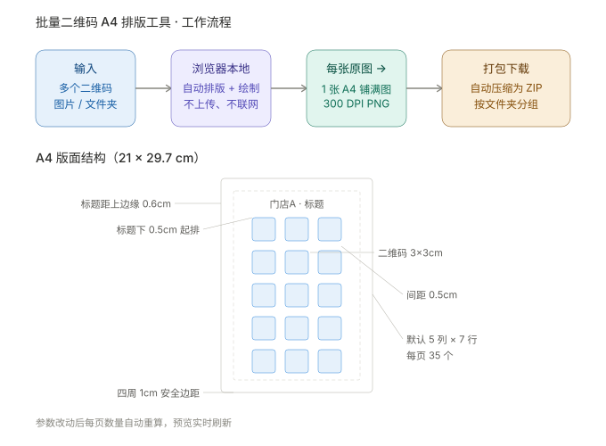

# 二维码 A4 排版打印工具

把一堆二维码图片，自动铺满 A4 纸，一键打包下载。

纯前端、零依赖、双击即用。**全程本地处理，不联网、不上传。**

> 📦 **批量二维码生成工具**（数据 → 二维码）已拆分到独立仓库：
> [batch-qrcode-html](https://github.com/Locallabstide/batch-qrcode-html)　·　
> [在线直接使用](https://locallabstide.github.io/batch-qrcode-html/)

---

## 这是什么

你手上有 50 张不同的二维码图片，需要每张都打印满一整页 A4（重复铺满，方便剪裁分发）。

用 Word 一张张排版要两小时，还容易对不齐。

**这个工具让你：** 把 50 张图一次性丢进去 → 自动排好版 → 打包成一个 ZIP 下载。整个过程几秒钟。

## 工作原理

## 功能特性

- **批量处理** —— 上传几张，就导出几张（一一对应）
- **A4 自动排版** —— 每张原图生成一张重复铺满该二维码的 A4 图片
- **参数实时可调** —— 二维码宽高、横纵间距（单位厘米），每页数量自动重算
- **标题文字** —— 可在输出图片上打印标题（默认取文件名，支持前后缀拼接）
- **文件夹导入** —— 支持一次导入多个文件夹，按文件夹分别打包成不同 ZIP
- **300 DPI 输出** —— A4 标准尺寸，印刷级清晰度
- **零依赖 ZIP 打包** —— 自研实现，无需任何第三方库
- **纯前端离线** —— 无网络请求、无上传、无需安装

## 快速开始

1. 下载 `qrcode-a4-layout.html`
2. 用 **Chrome / Edge** 打开（双击即可，无需服务器）
3. 上传二维码图片，或直接把文件夹拖进去
4. 点「批量导出（打包为 ZIP）」
5. 解压得到的 PNG，拿去打印

> ⚠️ **打印时务必选择「实际大小 100%」**，并关闭「适应页面」等自动缩放，否则尺寸会不准。

详细说明请看 [用户手册.html](用户手册.html)。

## 文件说明

| 文件 | 说明 |
|---|---|
| `qrcode-a4-layout.html` | 二维码 A4 排版工具（单文件，可直接使用） |
| `用户手册.html` | 操作手册（面向使用者） |
| `开发者手册.html` | 源码级技术文档 |
| `docs/工作原理.svg` | 工作原理示意图 |

## 技术栈

- 纯 HTML + CSS + JavaScript（原生，无框架）
- Canvas 2D 排版与绘制
- 手写 PKZIP 格式打包（CRC32 + 原生 `CompressionStream`）
- 单文件 IIFE 架构，`"use strict"`

架构细节、算法推导、性能分析与扩展指南见 [开发者手册.html](开发者手册.html)。

## 浏览器支持

| 浏览器 | 支持情况 |
|---|---|
| Chrome 103+ | ✅ 完整支持 |
| Edge 103+ | ✅ 完整支持 |
| Safari 16.4+ | ✅ 完整支持 |
| Firefox 113+ | ⚠️ 「导入整个文件夹」按钮不可用，请用**拖拽**方式 |

> 依赖 `CompressionStream` / `DecompressionStream`（Chromium 103+ / Safari 16.4+ / Firefox 113+）。老版本浏览器下 ZIP 会回退为存储模式。

## 隐私说明

所有处理均在你的浏览器本地完成，**不存在任何网络请求**，数据不会离开你的电脑。可断网使用验证。

## 相关项目

| 项目 | 用途 |
|---|---|
| [batch-qrcode-html](https://github.com/Locallabstide/batch-qrcode-html) | 批量二维码生成（数据 → 二维码），[在线使用](https://locallabstide.github.io/batch-qrcode-html/) |
| 本项目 | 二维码 A4 排版打印（二维码图片 → A4 铺满图） |

## 作者

**Yulai**

- E-mail：liyulai@qq.com
- GitHub：[@Locallabstide](https://github.com/Locallabstide)

## License

MIT License — 详见 [LICENSE](LICENSE)

---

*二维码 A4 排版打印工具 · Powered by Yulai @2026*
